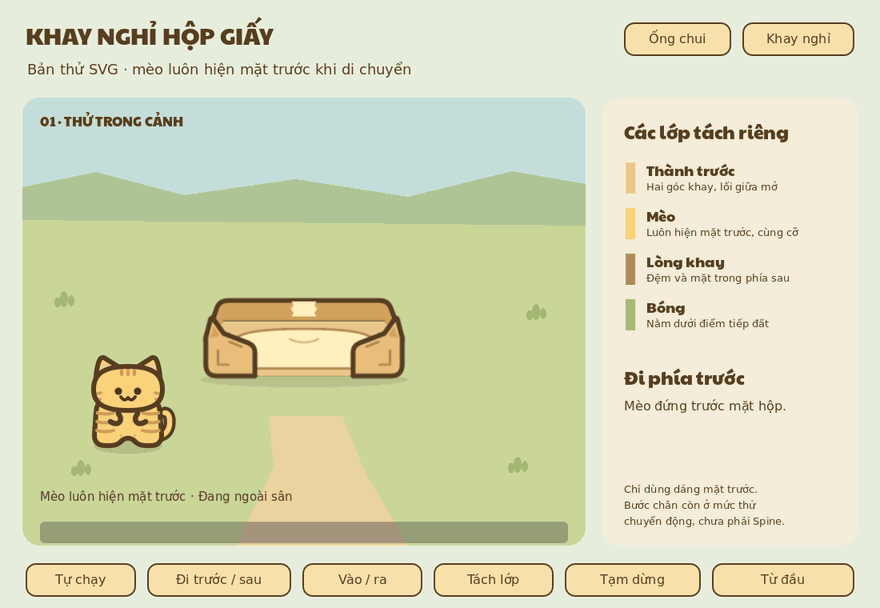

# Bản thử đồ giấy và mèo tương tác

Ngày: **2026-10-20**. Một demo Godot có thể chọn **Ống chui** hoặc **Khay nghỉ**
để kiểm tra SVG tách lớp, thứ tự trước/sau và vào/ra. **Mèo luôn hiện mặt trước
ở mọi trạng thái**; không đổi sang pose quay lưng, ngang hay quay người.
Project chạy riêng, chưa tích hợp vào sảnh game.

[Ống chui trên Figma](https://www.figma.com/design/2uKzqvXeOSPQqfaow6s7TU?node-id=77-2)
· [Khay nghỉ trên Figma](https://www.figma.com/design/2uKzqvXeOSPQqfaow6s7TU?node-id=82-2)
· [Pipeline đề xuất](../cardboard-castle-svg-pipeline/README.md)

## Xem bản thử

Mỗi GIF lấy từ **230 khung hình của chính demo Godot**, 10 fps, dài 23 giây.
Cả hai bản capture đều giữ mèo mặt trước.



| Vật thể | Clip | Bảng trạng thái | Proof SVG |
| --- | --- | --- | --- |
| Ống chui | [GIF mặt trước](tunnel-demo.gif) | [Ảnh trạng thái](interaction-review.png) | [Các lớp](art/art-review.png) |
| Khay nghỉ | [GIF mặt trước](bed-preview/bed-demo.gif) | [Ảnh trạng thái](bed-preview/interaction-review.png) | [Các lớp và mèo](bed-art/bed-review.png) |

## Chạy cửa sổ tương tác

Nhấp đúp [Open-Demo.cmd](Open-Demo.cmd) để mở **Khay nghỉ** mặc định. Hai nút
**Ống chui / Khay nghỉ** ở góc phải trên đổi vật thể trong cùng cửa sổ.
Hoặc từ thư mục gốc dự án chạy:

```powershell
powershell.exe -NoProfile -ExecutionPolicy Bypass -File "docs/design/2026-10-20/cardboard-tunnel-svg-pilot/Open-Demo.ps1"
```

[Open-Demo.ps1](Open-Demo.ps1) nhận thêm cờ `-Tunnel` để mở ống chui ngay từ đầu.
Tham số `ExecutionPolicy Bypass` chỉ áp dụng cho tiến trình này. Launcher mở
project [native/](native/) ở 1100×760 bằng Godot 4.7.2; đường dẫn Godot nằm trong
biến `$godotExecutable` nếu cần đổi máy. Tên cửa sổ là
**SVG Lobby Pilot - Meo mat truoc**.

| Nút | Tác dụng |
| --- | --- |
| **Ống chui / Khay nghỉ** | Chọn vật thể; đặt lại chu kỳ an toàn cả khi mèo đang ở bên trong |
| **Tự chạy** | Chạy lại toàn bộ chu kỳ đi trước, vòng ra sau rồi vào/ra cửa |
| **Đi trước / sau** | Lặp riêng phần kiểm tra thứ tự theo điểm chạm đất |
| **Vào / ra** | Lặp phần tiếp cận, vào nghỉ và đi ra, luôn giữ mặt trước |
| **Tách lớp** | Tạm giữ chuyển động và tách các lớp để xem cấu trúc; bấm lại để ghép |
| **Tạm dừng / Tiếp tục** | Dừng hoặc tiếp tục tại vị trí hiện tại |
| **Từ đầu** | Trở về đầu toàn bộ chu kỳ và ghép lại các lớp |

## Nguồn và cấu trúc lớp

Hai bộ asset dùng canvas **256×240**, điểm tiếp đất **(128,224)**. Mỗi bộ gồm
`source.svg`, `shadow.svg`, `rear.svg`, `interior.svg`, `front.svg` và `geometry.json`.
Không crop từng lớp để căn lại bằng mắt; `rear.svg` là mặt sau **của đồ vật**.

| Nguồn | Vai trò |
| --- | --- |
| [art/](art/README.md) | SVG và metadata ống chui |
| [bed-art/](bed-art/README.md) | SVG và metadata khay nghỉ, đệm kem nhạt |
| [native/Pilot.gd](native/Pilot.gd) | Đường đi, điểm handoff, thứ tự lớp và chuyển động của demo |
| [Mèo tabby gốc đã tách phần](../cat-spine-parts/svg/cat_tabby/) | Nguồn mèo mặt trước được demo sử dụng |
| [cat/](cat/README.md) | Lưu thử nghiệm quay lưng cũ; không được demo nạp |

Ngoài vật thể, Y-sort dựa theo điểm chạm đất. Bên trong dùng thứ tự **bóng →
vỏ sau → lòng/đệm → mèo → vỏ trước**. Đổi parent giữ global transform, không
thu nhỏ hay fade mèo. Lối giữa của cả hai front đều mở xuống mặt đất, không có
thanh ngang cắt thân/chân khi handoff. Mốc local trong `geometry.json` là gợi ý;
route thực tế nằm trong `Pilot.gd`.

## Kiểm tra đã thực hiện

- Hai chu kỳ capture 230 frame đều dùng `front_only_all_states`, không nạp pose sau.
- Đã kiểm tra đi trước/sau, vào nghỉ/đi ra, đổi vật thể khi đang có mèo và chế độ tách lớp.
- Cửa alpha thật mở xuống ground; không nhúng mèo vào SVG. Nét vật thể hiển thị
  5.9 px, nét mèo 6 px ở tỉ lệ demo.
- Alpha mèo bằng 1, cỡ giữ nguyên khi đổi lớp, Y-sort bật và các root cùng z-index.
- Demo chạy riêng, không sửa code game production; clip lấy từ capture Godot.

Số liệu: [ống chui](demo-validation.json), [khay nghỉ](bed-preview/demo-validation.json),
[QA art ống](art/qa.json), [QA art khay](bed-art/qa.json).

## Giới hạn hiện tại

**Hai vật thể chọn lần lượt, một mèo, đường đi cố định**, chưa phải sảnh có nhiều
đồ vật hoạt động đồng thời. Chân chuyển động đơn giản, chưa phải walk cycle có
kiểm soát tiếp đất hoàn chỉnh; không có rig/runtime Spine. Mèo mặt trước cố định
là lựa chọn thiết kế, không phải phần việc cần bổ sung pose khác.

Chưa triển khai nhiều mèo, đặt chỗ, navigation tự do, nâng cấp lâu đài hay kết nối
Home/BattlePage và lifecycle dữ liệu game. Đây là bước thử art và che khuất trước
khi sản xuất sảnh hoàn chỉnh.
