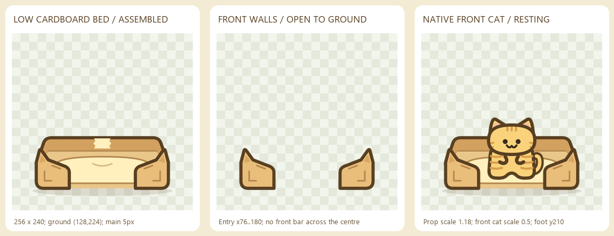

# Khay ngủ hộp giấy — asset SVG thử nghiệm

Ngày: **2026-10-20**. Vật thể thứ hai sau ống chui, dùng cùng hệ nét, màu bìa và
registration. Đây là bộ art tách lớp; chuyển động và tích hợp được kiểm tra riêng
trong demo. **Mèo luôn hiện mặt trước**, kể cả khi đi vào hoặc rời khay.

## Các lớp

| File | Vai trò |
| --- | --- |
| [source.svg](source.svg) | Bản ghép vector đầy đủ; không chứa mèo |
| [shadow.svg](shadow.svg) | Bóng tiếp đất dưới khay |
| [rear.svg](rear.svg) | Thành giấy phía sau và hai bên, miếng băng keo nhỏ |
| [interior.svg](interior.svg) | Sàn giấy và đệm kem nhạt |
| [front.svg](front.svg) | Hai góc gấp phía trước, để trống lối ở giữa |
| [geometry.json](geometry.json) | Bounds, registration, palette và mốc tương tác |
| [qa.json](qa.json) | Số liệu từ PNG render trong Godot ở tỉ lệ 3× |

Tất cả SVG giữ canvas và viewBox **256×240**, ground **(128,224)**. Không crop
theo alpha của từng lớp. Offset ảnh so với ground-root là **(-128,-224)** trước
khi scale. Thân giấy nằm trong khoảng **x24–232, y144–224** trước stroke;
bóng riêng kéo đến y236. Hình thấp, rộng, có hai góc gấp hơi nhọn, không lặp lại
silhouette cao của ống chui.

Thứ tự ghép: **shadow → rear → interior → front**. Khi mèo ở trong khay, chèn mèo
giữa `interior` và `front`. Mèo ngoài khay vẫn xếp trước/sau cả cụm theo chân;
không dùng một front overlay chung phủ lên mọi mèo.

## Lối vào không có thanh chắn

- Lối giữa theo hình học là **x76–180**, tâm **x128**.
- Hai thành trước không nối với nhau; không có sill hay stroke ngang qua lối.
- Tại local y199, y210, y220 và y224, khoảng alpha 0 liên tục là
  **x78.667–177.333**, rộng **98.667 px**, đã trừ stroke và mép antialias.
- Cột giữa x128 có alpha 0 từ y144 xuống hết y239; mèo có thể tiến từ dưới lên
  mà lớp trước không cắt ngang bụng/chân tại handoff.
- Mốc gợi ý: tiếp cận **(128,238)**, cửa **(128,224)**, nghỉ **(128,210)**,
  nghỉ sâu hơn **(128,202)**. Đây là local SVG, không phải tọa độ world.

Ở scale vật thể **1.18**, khoảng mở đo được rộng khoảng **116.43 px**. Proof dùng
mèo tabby mặt trước gốc ở visual scale **0.5**, canvas hiển thị 128×120; mèo giữ
nguyên cỡ. Đệm và các đường nằm trong `interior` được vẽ dưới mèo nên không đóng
vai trò thanh chắn trước cửa.

## Nét và màu

| Thành phần | Màu / nét |
| --- | --- |
| Viền chính | `#583f21`, **5 px** |
| Nếp gấp, đường đệm | `#b58950`, **2.5 px** |
| Mặt bìa trước | `#e9bd7a` |
| Thành sau | `#d3a15f` |
| Sàn giấy | `#e9c68a` |
| Đệm và băng keo | `#fff0be` |
| Mảng gấp góc | `#d8a762` |
| Đường lõm mềm trên đệm | `#d8bc86`, **2.5 px** |

Không gradient, ảnh nhúng hay chi tiết nhỏ dày đặc. Nét chính hiển thị **5.9 px**
ở scale 1.18, gần nét mèo gốc **6 px** ở scale 0.5. Các phần SVG không thêm nét
dọc đường cắt lớp; lớp trước sở hữu các mép gần người xem.

## Tái tạo và kiểm tra

1. `python build_art.py` tạo lại đủ 5 SVG và `geometry.json`.
2. Chạy `render_review.gd` bằng project Godot renderer riêng, truyền đường dẫn
   thư mục `bed-art` làm user argument đầu tiên. PNG 3× được ghi vào `png/`.
3. `python review_art.py` tạo `qa.json` và `bed-review.png`.

Đã render và xem proof. Toàn bộ lớp có cùng bounds; lớp trước có alpha thật tại
lối vào, thành bên có alpha 255, không SVG nào có phần tử `<image>`. Ghép các PNG
tách lớp so với render `source.svg` chỉ khác lượng trộn mép rất nhỏ: max 5/255,
mean absolute difference khoảng 0.00067 trên mỗi channel.

Proof là ảnh kiểm tra art với mèo mặt trước gốc được ghép riêng, không phải clip
chuyển động hoặc rig mới. Chưa xác nhận animation ngồi/nằm, va chạm, nhiều mèo,
reservation hay tích hợp vào game production. Không sửa native demo, ống chui
hoặc asset mèo trong bước tạo bộ art này.
