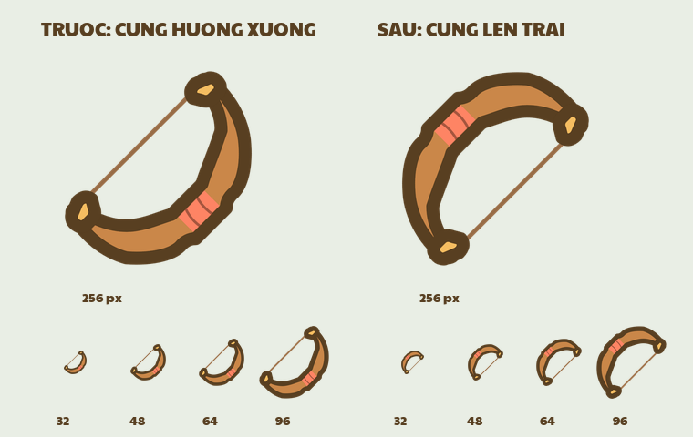

# Sửa hướng icon cung — 22/10/2026

Người dùng chỉ ra cung xoay 45° đang hướng xuống đất. Đã mở PNG production và lớp cung gốc để đối chiếu: lỗi nằm ở phép fit icon, không phải pose mèo cầm cung.

Installer cũ căn **dây cung từ dưới lên trên** vào góc màn hình −45°. Nhưng hướng bắn từ dây qua tay nắm vuông góc với dây; vì thế thân cung lại hướng xuống phải. Không thể dùng trục PCA hoặc góc của dây để chứng minh hướng bắn đúng.

Theo yêu cầu làm rõ **chỉ icon cung hướng góc trái trên**, sửa cung bằng trục **có hướng**, từ điểm dây ngang tay nắm `(96, 498)` đến tâm tay nắm `(282, 498)` trên nguồn 3×. Trục này được xoay lên trái, −135° trong hệ màn hình. Dây nằm chéo vuông góc với nó. Rìu và các vũ khí còn lại giữ hướng cũ; giữ nguyên nét, màu, silhouette, pose mèo và code hiển thị.

## Phạm vi và kiểm tra

- `python -B tools/ui/install_equipment_art.py --weapon-only cung` chỉ ghi năm biến thể icon cung 32/48/64/96/256 px. So sánh hash xác nhận 164 PNG production còn lại không đổi, bao gồm các mèo cầm vũ khí.
- `python -B tools/ui/test_bow_icon_orientation.py` kiểm tra ảnh raster thật: xác định tâm mực dây và màu tay nắm, yêu cầu tay nắm nằm trên trái của dây. Tất cả năm cỡ đạt; ảnh cũ thất bại ở cả năm cỡ. Kiểm tra này không dựa vào góc khai báo trong manifest.
- Đã mở và xem ảnh 256 px lẫn dải 32/48/64/96 px. Giữ khoảng trong suốt tối thiểu 8%, căn giữa và nét dây hiện có.
- `review.json` ghi các góc đo từ màu raster và danh sách đúng năm PNG đã đổi. `before-hashes.json` lưu mốc so sánh.

Đây là sửa hướng của **art production hiện có**. Bản thiết kế lại vũ khí Canvas được lưu riêng; sửa phép xoay này không biến bản vẽ cũ thành mẫu chuẩn về stroke hoặc thiết kế mới.
