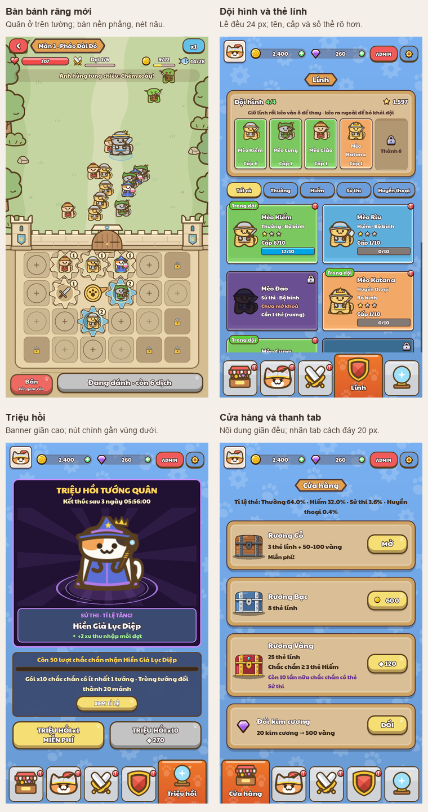
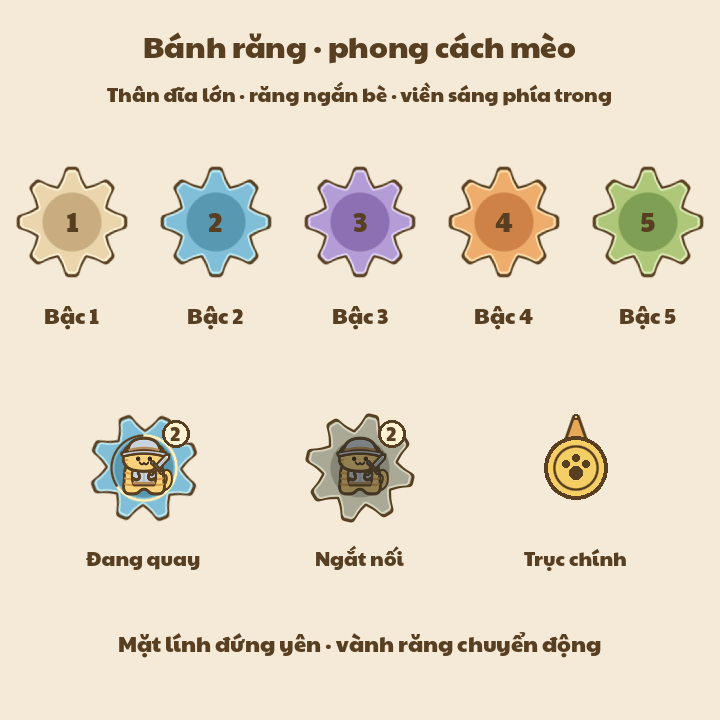
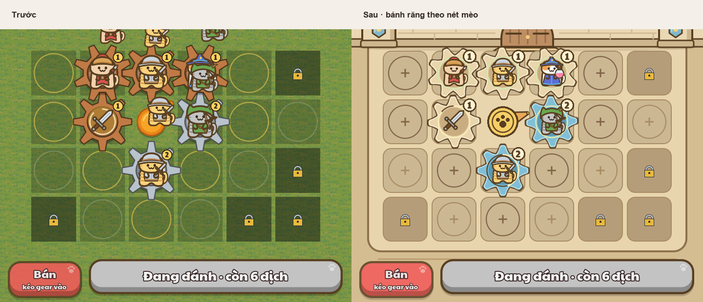
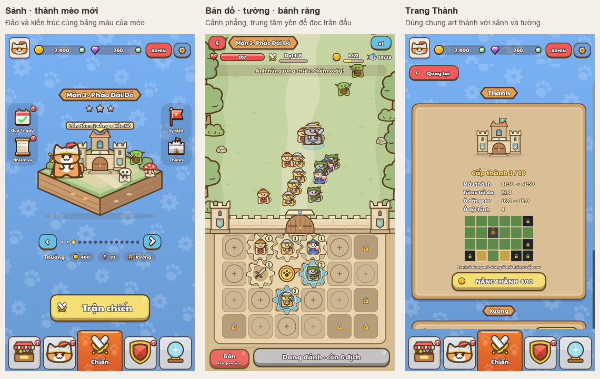

# Kết quả sửa UI, bánh răng, bản đồ và âm bấm

Đã sửa 5 vấn đề ghi trong [đánh giá ban đầu](before/README.md), hoàn thiện bánh răng v2, vẽ lại bản đồ/thành và thay âm bấm UI. Đã chạy lại các scene production qua Godot MCP và chụp 15 trạng thái ở 720×1280: 13 màn menu/popup, gồm trang Thành, và 2 trạng thái trong trận.

## Các thay đổi

| Vấn đề | Kết quả |
| --- | --- |
| Quân che bàn bánh răng | Quân xuất hiện theo cột gear, ở phía trên tường; điểm tập kết và biên di chuyển cũng nằm trong chiến trường. Nền cỏ dưới bàn được thay bằng mặt phẳng ấm, ô trống có viền rõ. |
| Chữ phụ nhỏ | Tăng chữ tên/cấp đội hình lên 18 px, tên thẻ lên 22 px, số thẻ lên 18 px; nội dung phụ shop/triệu hồi 20–22 px. Tên dài xuống dòng, chữ phụ trên nền sáng dùng màu nâu không viền. |
| Đội hình tràn lề phải | Năm ô chia theo chiều rộng thực của hàng. Khung hiện tại là `(24,189,672,317)`, giữ đủ lề 24 px ở hai bên. |
| Nhãn tab sát đáy | Tăng vùng nav lên 160 px, điều chỉnh icon và spacer; nhãn tab được chọn kết thúc ở y=1260, có 20 px đệm đáy. |
| Shop/triệu hồi dư khoảng trống | Các thẻ shop chia phần chiều cao còn lại; banner triệu hồi giãn, hai nút hành động nằm ở hàng dưới. |



**Thay đổi nhịp trận:** quân tiếp cận giao tranh sớm hơn vì không còn đi từ bàn bánh răng qua tường. Thời gian sinh quân, chỉ số và thuật toán chọn mục tiêu giữ nguyên; cần cân nhắc điểm xuất quân mới khi đánh giá cân bằng trận đấu.

Nguồn: [Battle.gd](../../../game/battle/Battle.gd), [Background.gd](../../../game/battle/Background.gd), [TroopsPage.gd](../../../game/menu/pages/TroopsPage.gd), [Home.gd](../../../game/menu/Home.gd), [Ui.gd](../../../game/ui/Ui.gd), [MenuPage.gd](../../../game/menu/pages/MenuPage.gd), [ShopPage.gd](../../../game/menu/pages/ShopPage.gd), [SummonPage.gd](../../../game/menu/pages/SummonPage.gd).

## Bánh răng theo phong cách mèo

**V2 — vẽ lại hình dáng theo mẫu đã xem.** Lượt v1 chưa làm rõ dáng bánh răng mà người dùng muốn; [ba ảnh v1](cog_v1/) được giữ nguyên để đối chiếu. V2 thay đổi thân và răng, đường viền phía trong, vùng tâm và bảng màu.

- Thân tròn dày, răng ngắn và rộng, các góc bo mềm; viền nâu `#583f21`.
- Một đường viền sáng liên tục chạy phía trong hình bánh răng; vùng tâm sẫm hơn mặt ngoài. Mảng màu phẳng, không gradient, bóng đổ, vệt bóng hoặc đinh tán.
- 5 màu bậc theo bảng màu game mèo: kem, xanh lam, tím, cam và xanh lá dịu. Ngắt nối dùng xám và chân dung tối hơn.
- Chân dung giữ thẳng khi vành quay; tăng nhãn bậc và đặt cung tiến độ ra ngoài chân dung.
- Trục chính giữ dấu chân mèo; dấu chân co theo kích thước trục để dùng được cả trong preview Thành thu nhỏ.

Nguồn hình đã xem: [`gear1`, Figma node `3447:18655`](https://www.figma.com/design/wMtwWaYIiKUchUdq5YdTm5/quocndc.b24ga124-s-team-library?node-id=3447-18655) và [`gear2`, node `3447:18668`](https://www.figma.com/design/wMtwWaYIiKUchUdq5YdTm5/quocndc.b24ga124-s-team-library?node-id=3447-18668). Hai PNG gốc được đọc từ thư mục ngoài workspace `C:\Users\dangp\OneDrive\Documents\first-project\output\gear-meow-full-png\assets\Standalone\Texture2D\gear1.png` và `gear2.png`; node, đường dẫn và SHA-256 có trong [chỉ mục asset](../../asset_reference/figma_assets.json). Các PNG này dùng để tham khảo hình dáng; texture trong game được dựng lại bằng SVG.





Generator nằm trong [make_svgs.py](../../../tools/ui/make_svgs.py), hàm `battle_cog`/`make_battle_cogs`; sáu file `battle_cog_*.svg` được dùng qua [CogDraw.gd](../../../game/battle/CogDraw.gd). [Gear.gd](../../../game/battle/Gear.gd) giữ chân dung thẳng; [GearBoard.gd](../../../game/battle/GearBoard.gd) vẽ ô trống và ô khóa; [Core.gd](../../../game/battle/Core.gd) đặt kích thước chốt.

## Bản đồ và thành

Bản đồ dùng nền đồng cỏ phẳng, cây/bụi/đá bo mềm ở hai bên và vùng trung tâm ít chi tiết để đọc giao tranh. Bàn bánh răng nằm trên nền ấm riêng. Thành mới dùng đá màu kem, mái và cờ xanh, dấu chân mèo; cùng một bộ kiến trúc xuất hiện trên đảo ở sảnh, trang Thành và tường trong trận.



Nguồn tạo art: [make_battle_map.py](../../../tools/ui/make_battle_map.py) sinh nền và 4 loại cảnh vật; [make_castle_art.py](../../../tools/ui/make_castle_art.py) sinh `menu_castle.svg`, `menu_castle_island.svg` và `battle_castle_wall.svg`. Đây là SVG mới, màu phẳng và viền nâu theo game mèo. [Background.gd](../../../game/battle/Background.gd) dùng art bản đồ/tường; [BattlePage.gd](../../../game/menu/pages/BattlePage.gd) dùng đảo thành ở sảnh; [CastlePage.gd](../../../game/menu/pages/CastlePage.gd) dùng hình thành. Lượt thay art này giữ đường tường, vùng điều khiển và dữ liệu nâng cấp hiện có.

## Âm bấm UI

Thay tiếng bíp vuông bằng tiếng chạm mềm kiểu game idle: phần thân trầm vừa và tiếp xúc ngắn, dài 72–76 ms. Ba biến thể rất gần nhau luân phiên khi bấm, peak 28% (−11,06 dBFS), được tạo từ dao động tắt dần và nhiễu lọc có seed; không dùng bản thu hoặc sample bên ngoài.

[Nghe file mẫu](../../../game/audio/ui/ui_tap_01.wav). [make_ui_taps.py](../../../tools/audio/make_ui_taps.py) tạo ba WAV PCM16 mono 22050 Hz trong [game/audio/ui](../../../game/audio/ui/). [SoundLib.gd](../../../game/core/SoundLib.gd) nạp âm bấm ngay khi khởi động, giữ API `play("click")`, tùy chọn Âm thanh và giới hạn chống phát trùng. Các nút/tab/popup hiện có dùng chung âm mới. Không thêm nhạc nền hoặc thay các hiệu ứng chiến đấu/phần thưởng.

## Kiểm tra

Các kết quả bên dưới đã chạy lại với bánh răng v2, bản đồ/thành mới và âm bấm mới.

| Kiểm tra | Kết quả |
| --- | --- |
| [DeploymentTest](test-results/DeploymentTest.log) | 29/29: bốn vai trò, cột xuất quân, biên di chuyển, sinh quân thật từ gear và địch gây sát thương thành. |
| [PinMeshTest](test-results/PinMeshTest.log) | 0 failures; đo cả nét vẽ SVG thực tế: khoảng hở với chốt 2,337 px, giữa hai gear 2,078 px. |
| [FishSkillTest](test-results/FishSkillTest.log) | PASS: cá đạt 3/3, gear kỹ năng có trên bàn, kỹ năng thi triển 4 lần. |
| [PopupCloseTest](test-results/PopupCloseTest.log) | PASS: nút Close nhận `pressed` và popup bị xóa. Sửa tọa độ input trong fixture với `push_input(click, true)`; không cần sửa popup production. |
| [SoundCheck](test-results/SoundCheck.log) | 29 âm/biến thể, 0 mục cần kiểm tra lại: dữ liệu không im lặng, không clipping, độ dài hợp lệ. |
| [UiTapRoutingTest](test-results/UiTapRoutingTest.log) | 9 kiểm tra, 0 lỗi: âm sẵn ngay, nút Ui/UiKit, tab và đóng popup phát một lần; tắt tiếng và chống phát trùng hoạt động. |
| [Số đo layout và SVG](test-results/layout.json) | 9/9: lề đội hình, nhãn nav ở 5 tab, biên CTA triệu hồi và 6 SVG bánh răng. Cả 16 nhãn tên thẻ trong nội dung cuộn có chiều cao ≥ 32 px, không đồng nghĩa cùng xuất hiện trên màn hình. Thêm 8 SVG bản đồ/thành có XML hợp lệ. |
| Chạy/chụp qua MCP | 15 trạng thái và mẫu bánh răng v2, không có lỗi GDScript. |

Log Godot có lỗi đọc Windows certificate store và cảnh báo ObjectDB khi thoát một số fixture; các cảnh báo này cũng xuất hiện ở lượt kiểm tra trước. Chưa kiểm tra cảm ứng thật, vùng an toàn thiết bị hoặc các tỷ lệ màn hình khác. Ảnh và số đo hiện tại chỉ xác nhận viewport 720×1280, kèm xem ảnh rộng 360 px. Kiểm tra âm xác nhận dữ liệu PCM và đường gọi phát; chưa đánh giá bằng nghe trên loa/tai nghe thực tế.

## Chạy lại

```powershell
# Tạo lại art và âm của lượt này, không tạo lại toàn bộ skin.
python -c "from tools.ui.make_svgs import make_battle_cogs; make_battle_cogs()"
python tools/ui/make_battle_map.py
python tools/ui/make_castle_art.py
python tools/audio/make_ui_taps.py
& 'C:/Users/dangp/OneDrive/Desktop/Godot_v4.7.2-stable_win64.exe' --headless --path . --import

node tools/review/mcp_ui_review.mjs docs/ui_review/2026-10-19/capture-plan.json
node tools/review/mcp_ui_review.mjs docs/ui_review/2026-10-19/fix-preview-plan.json
node tools/review/run_ui_checks.mjs DeploymentTest PinMeshTest FishSkillTest PopupCloseTest SoundCheck UiTapRoutingTest
python tools/review/build_review_overview.py
```

Các lượt chạy dùng profile tạm; fixture thay đổi dữ liệu người chơi đặt `PlayerData.persist=false`. Không cần rebuild theme cho art và âm mới vì chúng được preload trực tiếp.
