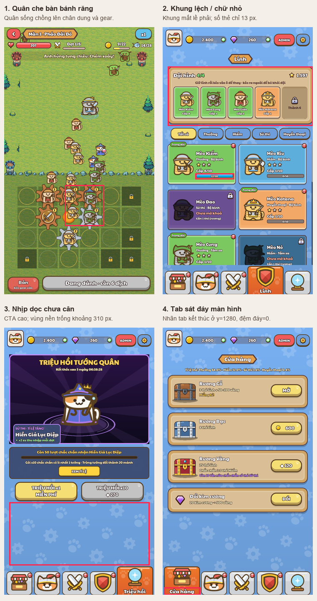

# Đánh giá UI game — 19/10/2026

Đây là bản đánh giá lịch sử trước khi sửa; ảnh và số đo trong thư mục này được giữ nguyên. Xem [kết quả sửa UI và bánh răng v2](../FIXES.md) cùng [ảnh hiện tại](../README.md).

Đã kết nối Godot MCP cục bộ và editor bridge tại `127.0.0.1:8765`, chạy các scene production để chụp **14 trạng thái ở 720×1280**. Các vấn đề đáng ưu tiên nằm ở độ rõ khi chơi, chữ phụ và khoảng cách bố cục.

Đã chạy lại cả hai lượt chụp qua MCP khi kiểm tra lại bản hiện tại: 14 ảnh được làm mới, các vấn đề bên dưới vẫn tái hiện. Vùng nhận chạm của tiền tệ là toàn bộ pill, không chỉ dấu “+”; không tính riêng kích thước icon “+” là lỗi vùng chạm.



## Các điểm nên sửa

### 1. Lính đang chạy che bàn bánh răng — ưu tiên vừa

Trong [ảnh đang chiến đấu](12_battle_fight.png), quân sống chồng lên chân dung gear bên phải và bánh răng trung tâm, khoảng x=290–478, y=755–953. Người chơi khó phân biệt quân vừa sinh với đối tượng kéo/thả trên bàn.

Nguồn: [Gear.gd:95](../../../../game/battle/Gear.gd#L95) sinh quân cách gear chỉ 30 px; [Battle.gd:276](../../../../game/battle/Battle.gd#L276) đặt quân tại đó; [Battle.tscn:24](../../../../game/battle/Battle.tscn#L24) vẽ lớp Units sau Board.

Đề xuất: tách điểm xuất quân khỏi vùng điều khiển; giữ quân sống phía trên mép bàn bằng một điểm xuất quân hoặc làn đi rõ ràng. Giảm chi tiết nền cỏ dưới bàn để ô trống nổi hơn. Cần kiểm tra lại khi đông quân trước khi chọn cách sửa.

### 2. Chữ phụ quá nhỏ khi xem ở kích thước điện thoại — ưu tiên vừa

[Tab Lính](04_troops.png) dùng 13 px cho số thẻ và 14 px cho tên/cấp trong đội hình. Khi thu ảnh rộng 720 về 360 px, chúng chỉ còn tương đương **6,5–7 px**. Dòng tỷ lệ cửa hàng và quy tắc triệu hồi là 15 px, kèm font đậm và viền dày, nên dấu tiếng Việt khó tách ở kích thước nhỏ.

Nguồn: [TroopsPage.gd:310](../../../../game/menu/pages/TroopsPage.gd#L310), [TroopsPage.gd:438](../../../../game/menu/pages/TroopsPage.gd#L438), [ShopPage.gd:21](../../../../game/menu/pages/ShopPage.gd#L21), [SummonPage.gd:33](../../../../game/menu/pages/SummonPage.gd#L33), [build_theme.gd:62](../../../../tools/ui/build_theme.gd#L62).

Đề xuất: tăng cỡ thông tin cần đọc thường xuyên, giảm số dòng trên thẻ; dùng chữ nâu không viền cho nội dung phụ trên nền sáng. Giữ chữ trắng viền cho tiêu đề và CTA. Đánh giá lại ở bản xem rộng 360 px, rồi kiểm tra trên thiết bị thật.

### 3. Khung đội hình lệch phải, bị cắt viền — ưu tiên vừa

Trong [tab Lính](04_troops.png), khung đội hình có rect **(24,189,698,284)**: mép phải ở x=722, vượt viewport 2 px và mất lề phải 24 px. Tiêu đề “Lính” cũng lệch phải khoảng 12,5 px. **Ô khóa thứ năm vẫn hiển thị đầy đủ**, không phải bị mất ô.

Nguồn: [TroopsPage.gd:12](../../../../game/menu/pages/TroopsPage.gd#L12), [TroopsPage.gd:46](../../../../game/menu/pages/TroopsPage.gd#L46), [TroopsPage.gd:271](../../../../game/menu/pages/TroopsPage.gd#L271); vùng chứa bị cắt tại [Home.gd:67](../../../../game/menu/Home.gd#L67).

Đề xuất: tính chiều rộng năm ô theo phần còn lại sau padding và khoảng cách; giữ lề trái/phải 24 px và căn tiêu đề theo viewport.

### 4. Nhãn tab dưới cùng không có đệm đáy — ưu tiên thấp

Ở cả năm tab, label tab đang chọn có rect y=1246, h=34: kết thúc **đúng y=1280**. Chữ chưa bị cắt rõ trong ảnh, nhưng sát mép và thiếu khoảng thở.

Nguồn: [Home.gd:34](../../../../game/menu/Home.gd#L34), [Home.gd:261](../../../../game/menu/Home.gd#L261), [Ui.gd:442](../../../../game/ui/Ui.gd#L442). Bố cục hiện dùng phần bleed 18 px để giấu đáy khối tab.

Đề xuất: dành đệm cho label riêng với phần nền tràn mép; kiểm tra vùng an toàn trên thiết bị có thanh cử chỉ. Chưa kiểm thử vùng an toàn trên điện thoại thật.

### 5. Cửa hàng và Triệu hồi phân bố chiều cao chưa cân — góp ý bố cục

[Cửa hàng](02_shop.png) kết thúc nội dung khoảng y=885; [Triệu hồi](05_summon.png) khoảng y=830. Nav bắt đầu khoảng y=1145, tạo vùng chỉ có họa tiết cao khoảng **260–315 px**. Riêng CTA triệu hồi nằm khá cao so với phần dưới màn hình.

Nguồn: [MenuPage.gd:30](../../../../game/menu/pages/MenuPage.gd#L30), [ShopPage.gd:14](../../../../game/menu/pages/ShopPage.gd#L14), [SummonPage.gd:14](../../../../game/menu/pages/SummonPage.gd#L14): nội dung hiện xếp dồn từ trên xuống.

Đề xuất: cho banner triệu hồi giãn theo chiều cao còn lại và đưa CTA xuống gần nav hơn; ở shop có thể giãn khoảng cách/chiều cao các hàng. Không cần thêm tính năng chỉ để lấp khoảng trống.

## Những phần đang ổn và giới hạn đánh giá

- Màu rarity, khung thẻ, nút và popup dùng phong cách tương đối nhất quán. Popup so sánh trang bị thể hiện rõ hai món và chênh lệch chỉ số.
- Popup Sự kiện, Quà 7 ngày, Nhiệm vụ và chi tiết trang bị đều nằm trong màn hình ở fixture này. Không xác nhận lỗi tràn nút Sự kiện; banner tím chỉ lệch 5 px so với hàng dưới, mức độ nhỏ.
- ADMIN chỉ xuất hiện trong debug/admin build theo `AdminGate.available()`; không tính là lỗi của giao diện bản phát hành.
- Phạm vi: 5 tab chính, 2 popup trang bị, chi tiết lính, Sự kiện, Quà 7 ngày, Nhiệm vụ, màn khóa, shop trong trận và đang chiến đấu. Chưa kiểm thử thao tác cảm ứng thật, tỷ lệ màn hình khác, toàn bộ animation mở thưởng hoặc mọi trạng thái dữ liệu.
- Dùng profile dữ liệu tạm trong thư mục báo cáo, `persist=false`. Không sửa code UI/gameplay. Hai lượt chụp kết thúc với exit code 0; có cảnh báo đọc Windows certificate store, không có lỗi GDScript trong các lượt chụp.

## Bằng chứng và chạy lại

- [Ảnh gốc trong thư mục này](.) và [rect/font của Controls](geometry.json).
- [MCP kết nối/kiểm tra](../mcp-inspect/mcp-results.json), [MCP menu](../mcp-capture/mcp-results.json), [MCP battle](../mcp-battle/mcp-results.json).
- Fixtures: [RuntimeSurvey.gd](../../../../tests/ui_review/RuntimeSurvey.gd), [BattleSurvey.gd](../../../../tests/ui_review/BattleSurvey.gd).

```powershell
node tools/review/mcp_ui_review.mjs docs/ui_review/2026-10-19/capture-plan.json
node tools/review/mcp_ui_review.mjs docs/ui_review/2026-10-19/battle-plan.json
python tools/review/build_review_overview.py
```
