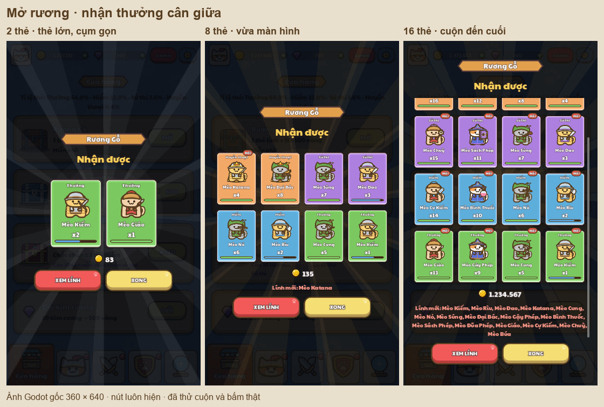

# Chest result layout

The result used to start at a fixed y=190 with small 0.62-scale cards, even for two
rewards. The title stayed detached at y=70, leaving most of the lower screen empty.

`ChestOpening._show_summary()` now centres the title, heading, rewards and actions
as one container group. Up to three cards use scale 1.12; longer lists use four
columns at scale 0.86. The rays follow the visible reward area. A bounded reward
scroll area keeps both 250×88 action buttons visible with 70px screen margins.
The opening/reveal animation and already-granted loot flow retain their behavior.

## Verification

Run `node tools/review/mcp_ui_review.mjs docs/ui_review/2026-10-19/chest-layout-plan.json`.
The fixture renders the real Home/Shop and ChestOpening using an isolated profile
with `PlayerData.persist = false`.

- 10 native captures: 720×1280 and 360×640, including two cards, eight cards,
  sixteen cards at the start and after scrolling, and gold without cards/callback.
- 30 route checks pass: fast summary, actual Skip/View Troops/Done clicks,
  mouse-wheel scrolling to the end, visible gold/new troops and unchanged granted
  loot before/after either exit. All geometry checks pass.
- The two-card result occupies `[30, 342, 660, 596]` in the 720×1280 design canvas:
  equal 342px space above/below, with 190×258 cards instead of 105×143 cards.
- The sixteen-card result fills the safe area; its scroll range is 178 design px.
- `PopupCloseTest` passes and `UiTapRoutingTest` passes 9/9 checks. Their logs live
  in `../test-results/`; the latter retains its existing exit cleanup warnings.

The final chest run exits 0 without script errors. Windows still logs the existing
certificate-store error. Evidence: `manifest.json`, per-image geometry JSON, and
`mcp/mcp-results.json`. Generate the montage with
`python tools/review/build_layout_overviews.py`.
