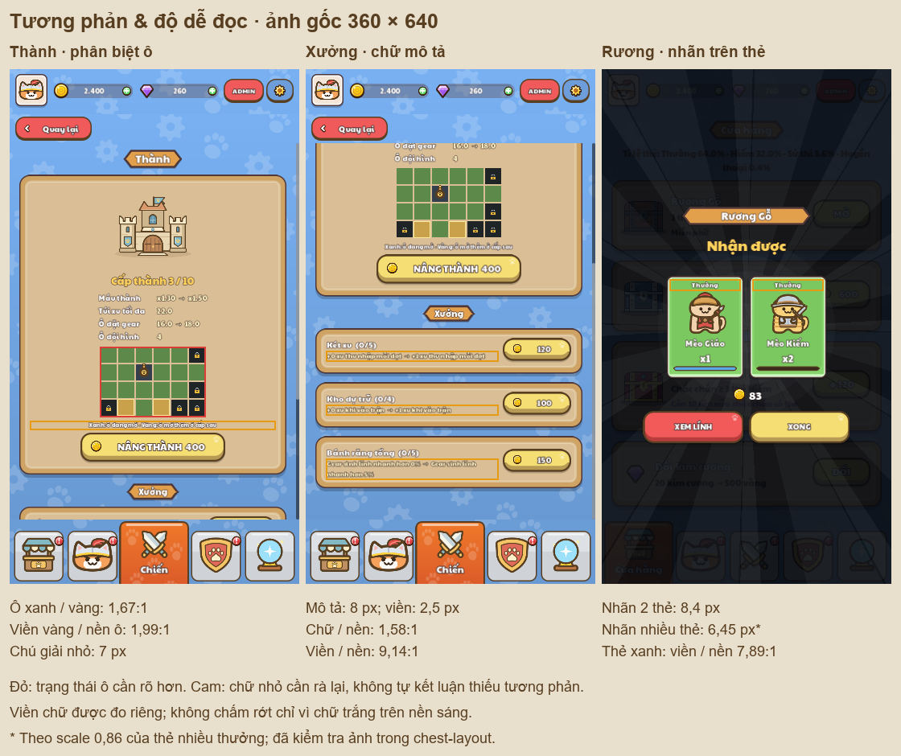

# Contrast and legibility review

Read-only review of the current lobby, Castle/workshop and chest result. Production
scripts, palette and game art were not changed for this audit.



## Findings, in priority order

1. **Castle grid states need stronger separation.** Green open cells versus gold
   future cells are only **1.67:1**. Future cells versus the Board are **1.37:1**;
   their pale border versus the cell fill is **1.99:1**, and versus the Board is
   **1.45:1**. The different outline helps, but is only a nominal 1px at 360×640.
   The green/gold legend is also only 7px. Add a dark border and a `+` or hatch to
   future cells, so the information has an additional visual cue. The existing
   game brown `#583f21` would give **4.04:1** against the future-cell fill.

2. **Castle descriptive text relies on a heavy halo at small sizes.** On the
   `#dabf96` Board, white is **1.77:1**, INFO cream **1.58:1**, and gold **1.24:1**.
   The dark outline is **9.14:1** against the Board and **16.17:1** against white;
   these labels are therefore not automatically contrast failures. However, the
   rendered workshop description is 8px, Castle statistics 9.5px, and the legend
   7px, with a nominal scaled outline setting of 2.5px. Native captures show dense
   small lettering and Vietnamese marks. Prefer the existing `UiKit.INK #3b2b1e`
   on this paper background (**7.66:1**, without an outline), larger descriptions
   and a shorter/wrapped legend. This is a proposed change, not applied.

3. **Chest rarity labels become too small in dense results.** At 360×640, two-card
   results use 8.4px rarity labels, 10.64px names and a nominal 2.8px outline.
   At scale 0.86, the four-column layout uses 6.45px rarity labels, 8.17px names and
   a nominal 2.15px outline; compare the existing `../chest-layout/` sixteen-card
   captures. The outline separates text from cards, but the tiny text needs more
   room or a larger font. Do not replace all card text with `UiKit.INK`: that ink
   only reaches about 4.44:1 on the purple card; use a darker choice for that tone.

## Areas that are working

| Pair | Contrast | Interpretation |
| --- | ---: | --- |
| Shortcut brown / cream caption | 8.69:1 | Strong contrast; captions remain small at 8px in the 360px image |
| Green/blue progress fill / dark track | 7.68:1 / 5.40:1 | Clear progress separation |
| White text / dark outline | 16.17:1 | Strong separation where a continuous halo is visibly preserved |
| Outline / yellow button face | 11.99:1 | Button text is supported by its outline |
| Outline / red button face | 4.92:1 | Button text is supported by its outline |
| Outline / green–purple reward cards | 7.89:1–5.29:1 | Separates text from the light card backgrounds |

The actual chest heading “Nhận được” samples **10.89–12.58:1** against the dimmed
background under its solid fill pixels. The gold amount is about **16.24:1**.
The dim/ray background is not the main readability problem in this reviewed state.

White fill on the yellow button alone measures 1.35:1; on the light reward cards
it is 1.99–3.05:1. These figures must not be reported as unconditional text failures
while ignoring the visible dark halo. Conversely, a high fill/outline ratio alone
does not prove tiny antialiased text is easy to read.

Disabled light-grey text on grey is about 1.57:1. Inactive controls are exempt from
the WCAG text contrast requirement; state clarity should be judged separately.
No claim of a complete WCAG pass/fail is made here.

## Method and evidence

- Eight new native Godot captures: lobby, Castle top, scrolled workshop and two-card
  chest result, each at 720×1280 and 360×640. The fixture uses an isolated profile
  with `PlayerData.persist = false`. It exits 0 with zero fixture failures and no
  script errors; the existing Windows certificate-store error remains in the log.
- Each view also has a `_background.png` capture with audited text transparent.
  Geometry is preserved. Scene processing is frozen during the capture pair.
  `manifest.json` records runtime font colours, outline settings, clipped screen
  rectangles and sizes after the actual render scale and card transform.
- `measurements.json` contains reproducible source-palette ratios and sampled
  background ratios under near-solid glyph fill pixels (10th/90th percentiles).
  The sample tolerance is 24 per RGB channel and excludes near-unchanged pixels.
  Small or clipped glyphs may have few samples; these are diagnostics, not an
  automatic accessibility judgement. Raster edge antialiasing is reviewed visually.
- Ratios use WCAG relative sRGB luminance: `(Llighter + .05) / (Ldarker + .05)`.
  The reference benchmarks are 4.5:1 for ordinary text, 3:1 for sufficiently large
  text, and 3:1 for necessary graphical boundaries. Halos are assessed separately.
  Rendered pixels here describe these screenshots, not physical device size or
  CSS text size on every target display. Nominal outline sizes are theme settings
  transformed into render pixels, not measured stroke widths of every glyph.

Regenerate with:

```text
node tools/review/mcp_ui_review.mjs docs/ui_review/2026-10-19/contrast-plan.json
python tools/review/audit_ui_contrast.py
```

Sources: `game/menu/pages/CastlePage.gd`, `game/menu/widgets/GridPreview.gd`,
`game/ui/ChestOpening.gd`, `game/ui/Ui.gd`, `game/ui/UiKit.gd`, the current SVG skin,
and `tools/ui/build_theme.gd`. This review does not cover combat, every popup,
all button interaction states or every colour-vision condition.
