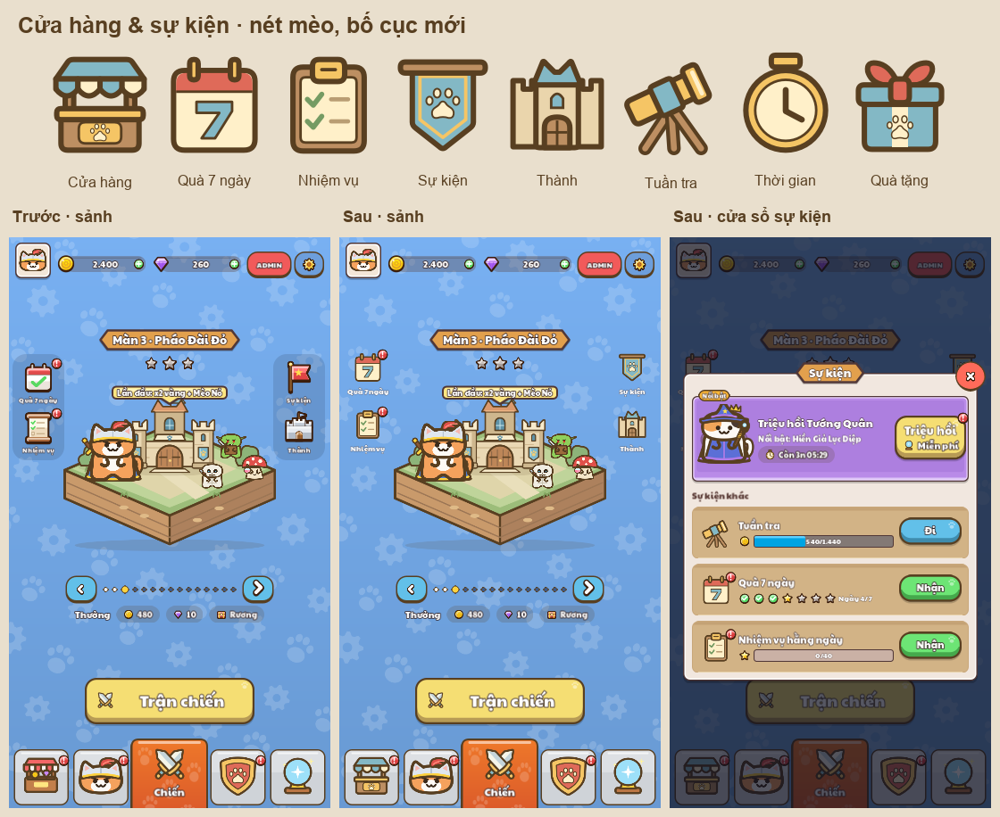

# Cửa hàng và sự kiện — 19/10/2026

Tạo lại tám họ icon theo nét mèo: quầy cửa hàng mái xanh–kem, lịch số 7, bảng nhiệm vụ, cờ hội chân mèo, thành đá ấm mái tai mèo, kính tuần tra, đồng hồ và hộp quà. Màu phẳng, viền nâu `#583f21`, dùng chung bảng màu với kiếm/khiên và thành mới. Đã sinh đủ 40 SVG ở 32/48/64/96/128 px.



## Bố cục

- Sảnh: bỏ nền dải tối chung; bốn lối tắt có cùng vùng bấm 96×108, icon 76 px, nhãn 16 px, cách nhau 20 px. Hai cột cách mép 16 px và căn cùng hàng, badge cùng vị trí. Sân khấu trung tâm có thêm khoảng thoáng.
- Cửa sổ Sự kiện: giữ khung rộng 660; icon và nút bấm cùng cột, hàng cao tối thiểu 116. Thanh tiến độ co giãn theo phần còn lại, tiêu đề có thể xuống dòng. Banner triệu hồi dành chỗ riêng cho nhân vật, nội dung và nút.

Nguồn art: [make_svgs.py](../../../../tools/ui/make_svgs.py), với danh sách `FLAT_FEATURE_ICONS` để các lần tạo lại dùng đúng kiểu màu phẳng. Layout: [Home.gd](../../../../game/menu/Home.gd), [Ui.gd](../../../../game/ui/Ui.gd), [MetaPopups.gd](../../../../game/menu/popups/MetaPopups.gd).

## Kiểm tra

- Godot 4.7.2 import thành công; 40 SVG parse XML hợp lệ, đúng kích thước và trùng chính xác đầu ra generator. Không có phần nét vượt canvas.
- Render tám ảnh Home/popup qua MCP ở cửa sổ native 720×1280 và 360×640, gồm tab Cửa hàng được chọn/chưa chọn, triệu hồi còn/hết lượt miễn phí và đăng nhập đã nhận đủ bảy ngày. Đã xem trực quan các ảnh và sheet năm kích thước.
- 22/22 kiểm tra click qua viewport đạt: mở/đóng Sự kiện, Quà 7 ngày, Nhiệm vụ; mở Thành và quay lại; chuyển tab Cửa hàng. Kết quả chi tiết nằm trong [manifest](manifest.json) và [log MCP](mcp/mcp-results.json).
- Các kiểm tra có sẵn `PopupCloseTest` và `UiTapRoutingTest` đều PASS (đường âm bấm 9/9).

Fixture dùng profile cách ly và `PlayerData.persist=false`. Lỗi certificate store Windows có sẵn vẫn xuất hiện trong log; lượt chạy thành công không có lỗi GDScript.

Chạy lại sau khi import art:

```powershell
node tools/review/mcp_ui_review.mjs docs/ui_review/2026-10-19/event-icons-plan.json
python tools/review/build_event_icons_overview.py
```

Ảnh đối chiếu: [icon trước/sau](before_after_icons.png). [Nguồn ảnh trước](before/README.md).
