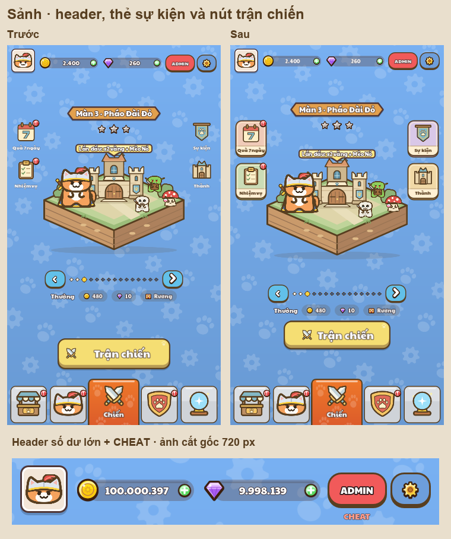

# Lobby layout review

The header now uses one shared centre line (y=54) for avatar, currency and tools.
CHEAT is positioned independently, so toggling it does not shift the row. Both
currency roots remain 201px wide in the debug fixture; long balances reserve room
for the currency icon and plus button and fit their font as needed.

Four independent 108×128 shortcut cards add pastel icon fields, cream caption
bands and the game's brown outlines. Their 16px captions have a 96px usable width;
the longest, “Quà 7 ngày”, measures 92px. Left/right gutters and vertical gaps match.
Rewards and battle action form one group with a 16px gap. The button centres its
swords and text together with a 12px gap.

Reference: [Figma layout page 3505:2](https://www.figma.com/design/wMtwWaYIiKUchUdq5YdTm5/?node-id=3505-2),
including lobby examples 3505:17 and 3505:103. The common header alignment, grouped
feature shortcuts and reward/action grouping informed the layout; the project's
cat artwork, palette and outlines remain its own.

`tests/ui_review/LobbyLayoutPreview.tscn` renders the real production Home with an
isolated profile and `PlayerData.persist = false`. It changes only the in-memory fixture.

The fixture captures native 720×1280 and native 360×640 images for four cases:

- `normal_lobby`: 2,400 gold, 260 gems, CHEAT hidden, level index 2 unlocked.
- `normal_locked`: the same profile, with locked neighbor level index 3 selected.
- `stress_lobby`: 100,000,397 gold, 9,998,139 gems, CHEAT visible, level index 2.
- `stress_locked`: the stress profile with locked neighbor level index 3.

Each case produces a full image, a native header crop, and a geometry JSON. The JSON
contains exact displayed currency text, visibility, minimum sizes, and control rectangles
for the named header, four shortcuts, island, pager, rewards, and battle action group.
`design_rect` uses the 720×1280 canvas; `render_rect` uses actual screenshot pixels.
Rectangles are `[x, y, width, height]`. The small images are rendered by Godot at 360×640.

Run the existing `tools/review/mcp_ui_review.mjs` with `lobby-layout-plan.json`.
The separate `lobby-layout-routes-plan.json` / `LobbyRoutesPreview.tscn` reuses the
existing EventIconsPreview script to cover the four shortcuts and their return paths
using real viewport mouse input (22 route checks), including free/paid Events branches.
Its exported output directory is `lobby-layout/routes`, and `routes_only = true` skips
screenshots and icon sheets. It preserves the previous `event-icons` review artifacts.

The `before/` folder preserves the latest native normal lobby captures immediately
before this header, shortcut-frame, and battle-action-spacing revision.

Verified results: 8/8 native captures and all geometry checks pass; normal/stress
header rectangles match and there are no peer overlaps. The route manifest records
22/22 successful actual-click checks at the two sizes. PopupCloseTest passes and
UiTapRoutingTest passes 9/9 checks (rerun during the chest-layout follow-up).
Windows logs the existing certificate-store error; UiTapRoutingTest also retains
its existing exit cleanup warnings (2 objects and 1 resource). These are recorded
in `../test-results/`, separate from the passing interaction results.

Generate the montage with `python tools/review/build_layout_overviews.py`.
