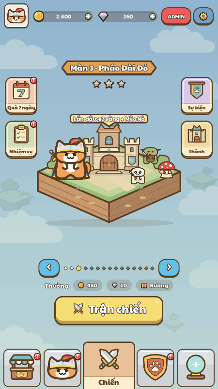

# Menu background motion review

Native production Home at **450×800**: **13 captures, 14 passing checks, 32 real-time motion frames, 0 failures**. Godot exited with code 0 and no shader/GDScript errors. The existing Windows certificate-store message remains in the runtime log.



## What was verified

- The sky changes at shader times 0, 5, and 10 seconds.
- UI tweens and processing are paused separately during this review. All UI rectangles stay identical; the three isolated foreground images are byte-for-byte identical. Production UI animation is not changed by the fixture.
- A second capture uses the shader's real `TIME` for 32 frames at 8 fps, exported as the 4-second GIF above.
- Actual navigation clicks open Cửa hàng with the old gear/paw pattern, then return to the animated sky on Chiến.
- Castle overlay at time 5 seconds has exactly the same isolated background pixels as the full-screen lobby at time 5 seconds. Its actual back button returns to the lobby.
- Every capture is 450×800. The player state remains in memory with `PlayerData.persist = false`, and the MCP client isolates APPDATA/LOCALAPPDATA under `mcp/profile/`.

## Pixel audit

| Comparison | Changed pixels | Image area |
| --- | ---: | ---: |
| Isolated background, 0 → 5 seconds | 13,086 | 3.6350% |
| Isolated background, 5 → 10 seconds | 12,257 | 3.4047% |
| Real-time first → last frame | 8,883 | 2.4675% |
| Castle background → lobby background, both at 5 seconds | 0 | 0% |
| Isolated UI foreground across 0, 5, 10 seconds | 0 | 0% |

The real-time source sequence spans 26–3,872 ms after recording began. The GIF has 32 frames and a 4,000 ms playback duration, with a shared palette to keep UI colors stable.

The identical foreground SHA-256 is `b712f9ec815c6790ca2181a2e5d1aafb18ff259a95ce24a79762de2dced5a8a1`.

## Captures and reproduction

- [Lobby at 0 seconds](lobby_t00_450x800.png) · [5 seconds](lobby_t05_450x800.png) · [10 seconds](lobby_t10_450x800.png)
- [Shop using its old pattern](shop_pattern_450x800.png)
- [Return to the sky](lobby_return_t05_450x800.png)
- [Castle overlay](castle_overlay_t05_450x800.png)
- [Complete runtime manifest](manifest.json) · [Pixel audit](pixel-audit.json) · [MCP runtime log](mcp/mcp-results.json)

```powershell
node tools/review/mcp_ui_review.mjs docs/ui_review/2026-10-19/menu-background-motion/plan.json
python docs/ui_review/2026-10-19/menu-background-motion/make_motion_preview.py
```

The fixture freezes shader time with `motion_speed = 0` and `time_offset = 0/5/10`, then uses `motion_speed = 1` for the real-time sequence. Each static capture has a matching `_geometry.json`; the original real-time PNGs are in `motion_frames/`.
