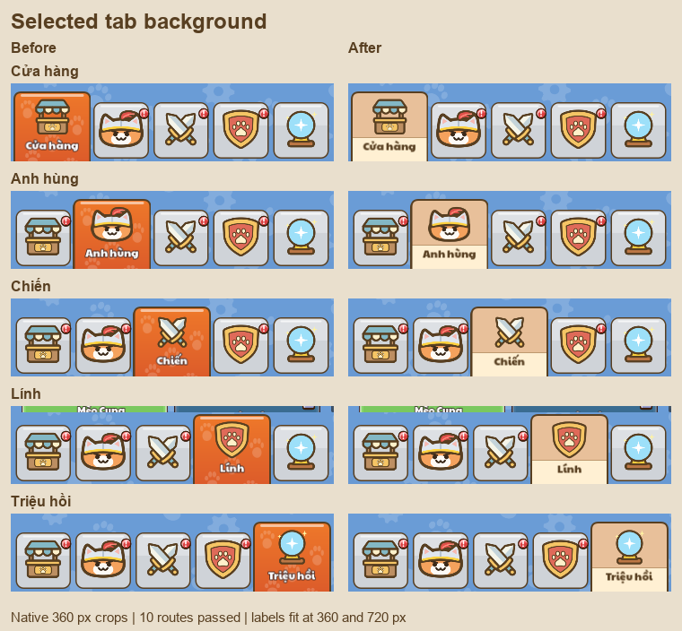

# Selected navigation background

Changed the selected state shared by all five Home tabs:

- Flat muted peach `#e8c09a` replaces the orange gradient, paw pattern and white shine.
- A separate cream `#fff0d3` footer follows the caption layout, so its separator stays aligned when the panel stretches.
- Caption uses brown `#583f21`, with no outline: contrast 8.69:1.
- Existing icon position, selected-tab width and tap targets are preserved. Caption moves down 2 design pixels (1 native pixel at 360 px).



Validation:

- Godot MCP: 10 native captures, five tabs at 720×1280 and 360×640; 10 actual pointer routes, zero failures.
- Geometry comparison: all tab rectangles unchanged; every caption fits its width and remains fully visible. See `verification.json` and `manifest.json`.
- `UiTapRoutingTest`: 9 checks, zero failures, including UI sound routing.
- Rebuilt theme was compared after resolving generated resource IDs: only `NavSelected` and the added `NavSelectedFooter` properties changed.
- Visual review of all five selected states, including the longer Cửa hàng / Anh hùng / Triệu hồi captions, passed.

The test uses an isolated profile with persistence disabled. The Windows certificate-store diagnostic also appears in baseline captures and is unrelated to this change.

Reproduce the current captures:

```powershell
node tools/review/mcp_ui_review.mjs docs/ui_review/2026-10-19/nav-focus-plan.json
```

`before/` contains the captured original state; do not regenerate it from the updated UI.
