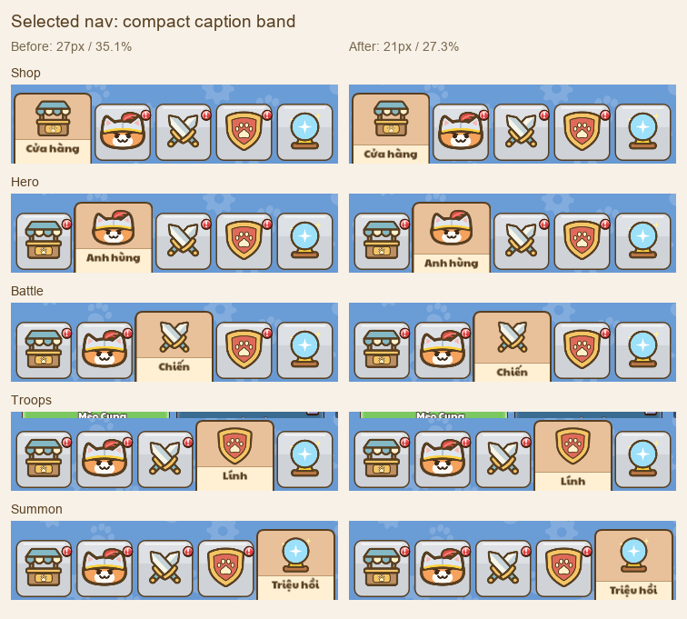

# Compact selected navigation footer

The selected tab's cream caption band is smaller, while the icon size, icon position,
tab widths, total bar height and pointer targets remain the same.



At the production bottom bleed of 18 design pixels:

| Measurement | Before | After |
| --- | ---: | ---: |
| Icon holder height, design px | 88 | 100 |
| Visible cream band, design px | 54 | 42 |
| Visible cream band at 360px width | 27px | 21px |
| Fraction of visible colored tile | 35.1% | 27.3% |
| Selected bar minimum height | 166px | 166px |
| Caption font size, design px | 24 | 24 |
| Caption outline | 0 | 0 |

The 12 design pixels removed from the caption's lower padding move into the icon
holder. The holder starts at the same position, so its anchored icon stays in place.
The cream footer is still a separate layout control attached to its caption.

## Verification

- Production Home, five tabs at native 720×1280 and 360×640: 10 screenshots.
- Actual viewport pointer events selected every tab: 10 passing routes.
- Exact before/after geometry comparison passed for all 10 screens: same icon rect,
  cell rects and bar rect; captions fit and remain fully visible.
- Before and after use separate isolated profiles and `PlayerData.persist=false`.
- Existing `nav-focus` evidence was preserved. This review covers the navigation bar;
  the Troops redesign is verified separately.

Machine-readable evidence: [verification.json](verification.json), [manifest.json](manifest.json),
[baseline manifest](before/manifest.json), [MCP output](mcp/mcp-results.json).

```powershell
node tools/review/mcp_ui_review.mjs docs/ui_review/2026-10-19/nav-footer-compact-plan.json
node tools/review/verify_nav_footer_compact.mjs
python tools/review/make_nav_footer_compact_overview.py
```

The historical baseline is captured by `nav-footer-compact-before-plan.json` before
the two layout values change. Do not rerun that baseline against the compact version.

The Godot runs completed successfully. Windows continues to report the pre-existing
root certificate store message on stderr.
