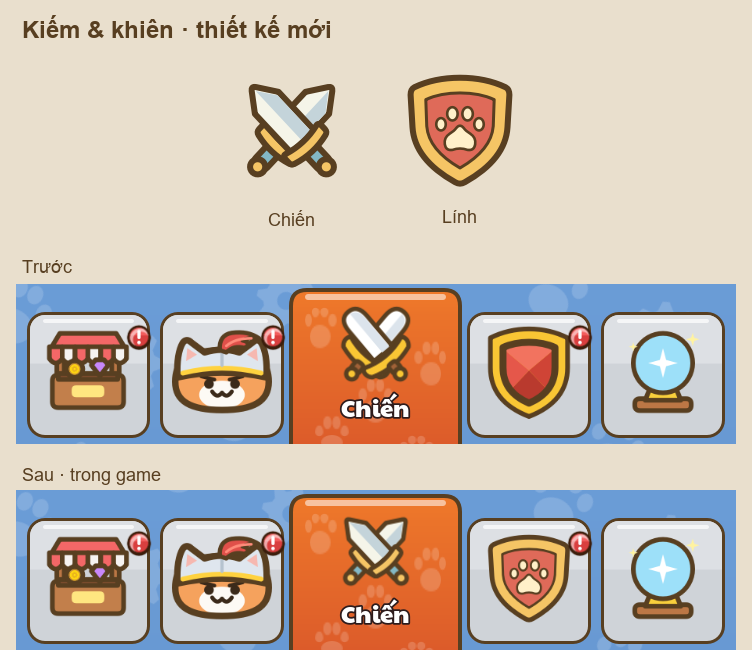

# Kiếm và khiên — 19/10/2026

Đã thay hai icon Chiến/Lính bằng cặp mới theo nét vẽ mèo: kiếm ngắn có mũi bo nhẹ, chắn tay vàng gọn và chuôi xanh; khiên rộng với mặt đỏ đất, viền vàng và huy hiệu chân mèo màu kem. Màu phẳng, viền nâu `#583f21`.

Nguồn là hai định nghĩa `tab_battle`/`tab_army` trong [make_svgs.py](../../../../tools/ui/make_svgs.py). Đã sinh lại đủ 10 SVG: hai họ icon ở 32/48/64/96/128 px. Tab chọn dùng bản 96, tab chưa chọn dùng bản 128. Icon Chiến trên nút vào trận và HUD cũng dùng chung art mới.



## Kiểm tra

Godot 4.7.2 import thành công. Chạy Home thật qua MCP ở hai tab Chiến/Lính, tại hai kích thước cửa sổ 720×1280 và 360×640; bốn ảnh render native, không resize. Sheet kiểm tra cả năm kích thước asset. Không cắt nét, không chạm nhãn, chân mèo vẫn nhận diện được ở bản nhỏ. Không có lỗi GDScript; Godot vẫn báo lỗi certificate store Windows vốn có.

[Manifest](manifest.json), [kết quả MCP](mcp/mcp-results.json), [sheet kích thước](icon_sizes_32_48_64_96_128.png). Fixture dùng profile cách ly và `PlayerData.persist=false`.

Chạy lại sau khi import art:

```powershell
node tools/review/mcp_ui_review.mjs docs/ui_review/2026-10-19/nav-icons-plan.json
```
