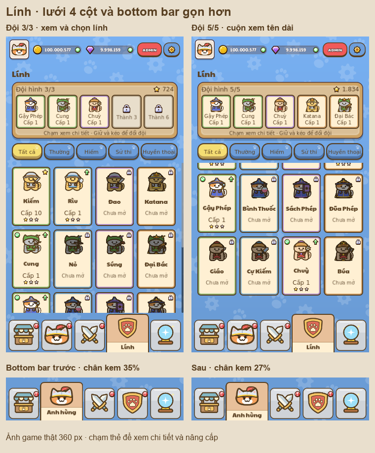

# Lính — lưới 4 cột trong game

Review dùng **Home/TroopsPage thật**, sau khi sinh SVG, import và build theme hoàn tất. Save người chơi được cách ly bằng APPDATA/LOCALAPPDATA riêng; `PlayerData.persist = false`.

Ảnh native:

- [Thành 1, đội 3/3 — 360 × 640](starter_all_360x640.png)
- [Thành 6, đội 5/5 — 360 × 640](late_all_360x640.png)
- [Cuộn đến cuối — 360 × 640](starter_all_scrolled_360x640.png)
- [Tên dài ở bộ lọc Huyền thoại — 360 × 640](starter_legendary_360x640.png)
- [Thành 1 — 720 × 1280](starter_all_720x1280.png)

Kết quả: **24 ảnh native, 66 tuyến tương tác bằng chuột, 0 lỗi kiểm tra**. Cả hai lần chạy Godot thoát mã 0. Chỉ còn thông báo kho chứng chỉ Windows có sẵn ở các review trước; không có lỗi script.

Đã kiểm tra:

- Hai kích thước 360 × 640 và 720 × 1280, đội hình 3/3 ở Thành 1 và 5/5 ở Thành 6.
- Cả năm bộ lọc bằng con trỏ thật; số lính và độ hiếm khớp bộ lọc.
- Một lần chạm bộ lọc phát âm thanh click đúng một lần, xác nhận bằng chỉ số vòng lặp sample trước/sau chạm ở mỗi kích thước native.
- Lưới luôn 4 cột bằng nhau, không tràn ngang. Tên ngắn bỏ tiền tố “Mèo”, tên hai dòng hiện đầy đủ; nhãn và chân dung nằm trong thẻ.
- Lính khóa, đã mở, trong đội; Kiếm ở trần cấp đủ thẻ lên sao; Rìu có thể nâng cấp.
- Chạm Kiếm mở chi tiết, lên sao và nâng cấp; sao/cấp tăng đúng một lần, vàng/thẻ trừ đúng chi phí. Đóng bằng nút X thật.
- Chạm lính khóa mở phần giải thích và không có nút nâng cấp.
- Cuộn bằng bánh xe tới cuối danh sách, kéo đổi hai ô đội hình và kéo Rìu từ bộ sưu tập vào ô đội hình.

Ở màn 360 px, tên/cấp hiện dùng font **12 px** (24 px design), thẻ rộng **78,5–79,5 px** tùy bộ lọc có thanh cuộn hay không và cao **120 px**. Vùng tên cao 34 px native, đủ hai dòng cho các tên dài như “Sách Phép”. Kiểm tra tên xác nhận hiển thị đầy đủ; không thay thế đánh giá độ dễ đọc trên thiết bị thật.

Chạy lại: `node tools/review/mcp_ui_review.mjs docs/ui_review/2026-10-19/troops-compact-plan.json`.

Plan chia hai scene theo kích thước native để mỗi lệnh MCP nằm trong giới hạn 15 giây. `manifest_720.json` và `manifest_360.json` là kết quả của từng scene; `manifest.json` gộp kết quả của lần review này. Các file `*_geometry.json` ghi lại vị trí, kích thước, font và số dòng của nhãn.

Bottom bar đã thu dải kem từ 35,1% xuống 27,3%, giữ nguyên rect icon và vùng chạm. Xem `../nav-footer-compact/verification.json`: 10 ảnh và 10 lượt bấm đều đạt.

Kiểm tra bổ sung ở `checks/`: `UiTapRoutingTest` đạt 9 kiểm tra; `PopupCloseTest` đạt. `theme-scope.json` xác nhận các giá trị theme khác ngoài nav/thẻ lính không đổi sau khi bỏ khác biệt ID tự sinh. Tương phản chữ nâu/nền kem đạt 8,69:1; chữ phụ đạt 6,18:1 và 5,21:1 trên các nền thẻ.

Tạo lại ảnh tổng hợp: `python tools/review/make_troops_compact_overview.py`.
