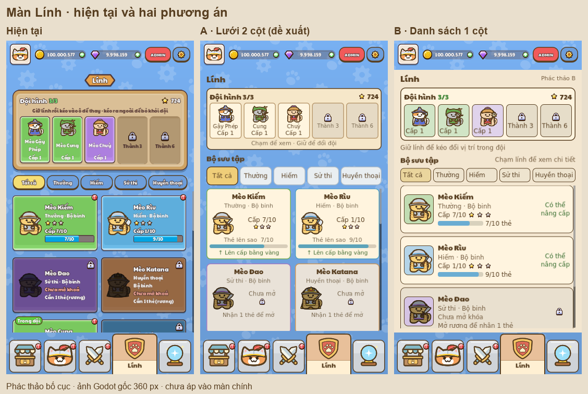

# Đánh giá và phương án màn Lính

Đây là đề xuất bố cục, dựng bằng scene Godot riêng; chưa áp dụng vào màn chính. Các ảnh dùng cùng trạng thái đội hình 3/3 và cùng số dư. Profile chạy riêng, `PlayerData.persist = false`.



## Vấn đề hiện tại

1. Đội hình và bộ sưu tập đều là nhiều thẻ màu, viền dày và chữ trắng có stroke. Hai phần có độ nhấn tương đương, khó nhận ra đâu là đội đang dùng và đâu là kho lính.
2. Khối đội hình cố định khoảng 155 px ở màn 360 px, nhưng chân dung trong ô chỉ khoảng 36 px. Tên dài làm ô cao; hai ô khóa cũng chiếm cùng diện tích.
3. Thẻ danh sách khoảng 163×108 px chứa tên, phẩm chất, hệ, sao, cấp, số thẻ, nhãn đội và dấu báo. Chữ phần lớn chỉ 9–11 px, có viền nên nét và dấu tiếng Việt dễ dính.
4. Thanh `7/10` không tự giải thích đó là thẻ lên sao; đặt cạnh `Cấp 7/10` dễ nhầm hai loại tiến trình.
5. Năm nút lọc chỉ cao khoảng 29 px, chữ nhỏ, tất cả có viền đậm. Nhãn Huyền thoại dài và sát mép.
6. Thẻ khóa bị tối cả hình lẫn nền, sau đó lặp nhiều dòng chữ nhỏ. Nhãn “Trong đội” nằm ngoài thẻ khiến mép hàng lổn nhổn; dấu đỏ chưa giải thích loại nâng cấp.

## A — lưới 2 cột, đề xuất

- Tựa Lính và Bộ sưu tập canh trái, có phân cấp rõ.
- Đội hình khoảng 118 px: chân dung, tên ngắn (bỏ tiền tố “Mèo”), cấp. Hàng đầu đặt 3/3 và lực chiến; hướng dẫn rút thành một câu. Hai ô khóa giữ điều kiện Thành 3/6.
- Thẻ khoảng 160×134 px, tên chiếm toàn chiều ngang. Nền kem/chữ nâu; phẩm chất nằm ở viền và dòng chữ để không phụ thuộc riêng vào màu.
- Tên khoảng 13 px, nội dung 11–12 px ở màn 360 px. Font Paytone dùng cho tiêu đề, DejaVu Sans có sẵn dùng cho nội dung nhỏ; bỏ stroke trên nền sáng.
- Ghi rõ “Thẻ lên sao”, phân biệt trạng thái lên cấp bằng vàng / đủ thẻ lên sao. Dấu đội hình nằm trong thẻ.
- Bộ lọc khoảng 36 px cao; chỉ mục đang chọn có màu và viền nổi. Khi triển khai cần cho vùng chạm đạt 40–44 px nếu khoảng cách cho phép.
- Chỉ bộ sưu tập cuộn. Thanh cuộn luôn cho thấy còn lính bên dưới; đội hình và bộ lọc đứng yên.

Ảnh: [360 px](grid_360x640.png), [720 px](grid_720x1280.png), [cuộn tới cuối](grid_scrolled_360x640.png).

## B — danh sách 1 cột

Mỗi lính là một hàng khoảng 92 px với cột chân dung, thông tin và trạng thái. Dễ đọc tên/chỉ số hơn, nhưng chỉ thấy khoảng ba lính cùng lúc. Phù hợp nếu trọng tâm là so sánh và quản lý từng lính; A giữ cảm giác duyệt bộ sưu tập tốt hơn.

Ảnh: [360 px](rows/rows_360x640.png), [sau khi cuộn](rows/rows_360x640_scrolled.png). B minh họa cách chia hàng; khi triển khai nên bổ sung tên ngắn trong đội hình và phân biệt hai loại nâng cấp như A.

## Phạm vi tiếp theo nếu triển khai A

Giữ các thao tác hiện có: chạm mở chi tiết, giữ/kéo thay đội, kéo ra để gỡ; nâng cấp và lên sao tiếp tục ở chi tiết. Không phát sinh nút tối ưu đội hay sắp xếp tự động. Kiểm tra đội trống/đủ, 3–5 ô, chọn thay thế, lính có thể lên cấp/lên sao, thẻ khóa, tên dài và cuộn ở điện thoại.

## Kiểm tra bản phác thảo

- A/B render native 360×640 và 720×1280 bằng Godot MCP, exit 0, không lỗi script.
- A đo chiều rộng toàn bộ nhãn của tất cả lính, bao gồm Mèo Bình Thuốc và Mèo Sách Phép: không tràn; xem `grid-labels.json`.
- Đã xem ảnh đầu/cuối danh sách. Đây là kiểm tra render của phương án, chưa phải kiểm thử hành vi UI sau triển khai.
- Tham khảo phân cấp đội hình / bộ sưu tập từ Figma `wMtwWaYIiKUchUdq5YdTm5`, node `3523:21`; sử dụng hình mèo và font sẵn của dự án.

Tái tạo ảnh:

```powershell
node tools/review/mcp_ui_review.mjs docs/ui_review/2026-10-19/troops-proposals/grid-plan.json
node tools/review/mcp_ui_review.mjs docs/ui_review/2026-10-19/troops-proposals/rows-plan.json
```
