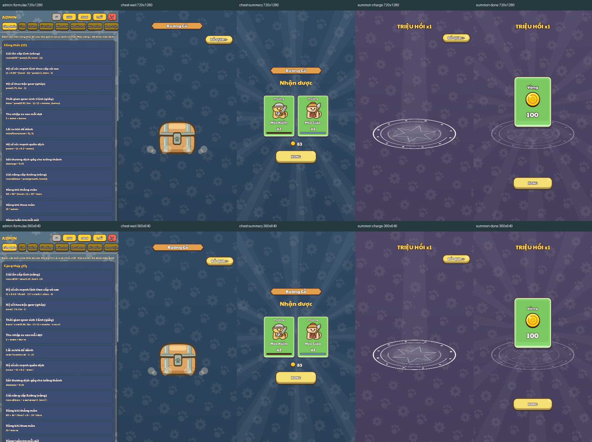

# Menu CanvasLayer surface review

Native compatibility-renderer captures of the actual Home, Admin, ChestOpening and SummonOpening at **720×1280** and **360×640**. Final run: **97 checks, 10 captures, 0 failures**. The save profile is isolated under this folder; PlayerData persistence is disabled before building Home. Opening inputs mirror already-granted results and never purchase or grant loot.



Verified behavior:

- Admin gets its own full-screen pattern on its CanvasLayer; the courtyard pauses. Native close restores the courtyard.
- Chest wait and summary retain a visible blue scrolling pattern; skip and Done work. The underlying menu chrome is hidden and restored on exit.
- Summon charge and results retain a violet scrolling pattern. Skip and Done work. Returning to Shop restores its header, content, navigation and awning.
- Openings temporarily hide a full-page Castle overlay and restore that overlay on close.
- Nested sheet registration finds Home through its ancestors. Freeing the parent sheet clears both surface records.
- Freeing Home with a live opening clears the CanvasLayer and its surface.
- Hosts outside Home preserve the original dark opening fallback.
- Chest and summon presentation leave gold, gems and troop state unchanged.

All ten captures were visually inspected, including a contact sheet at the native smaller size. Patterns remain visible below opening effects and reward cards. Text and buttons remain readable; Admin's original dense layout is unchanged. Final engine log contains only the existing system certificate-store warning, with no script or assertion errors.

Fixture: `tests/ui_review/MenuSurfaceReview.tscn`.

Run in PowerShell from the repository root:

```powershell
$env:APPDATA = Join-Path $PWD 'docs/ui_review/2026-10-21/menu-surface-review/profile'
$env:LOCALAPPDATA = $env:APPDATA
& 'C:/Users/dangp/OneDrive/Desktop/Godot_v4.7.2-stable_win64.exe' --path . --rendering-method gl_compatibility --resolution 720x1280 --log-file docs/ui_review/2026-10-21/menu-surface-review/godot.log res://tests/ui_review/MenuSurfaceReview.tscn
```

The companion `MenuPatternBackground.tscn` fixture covers main tabs, page overlays, event transitions and the preserved combat scene.
